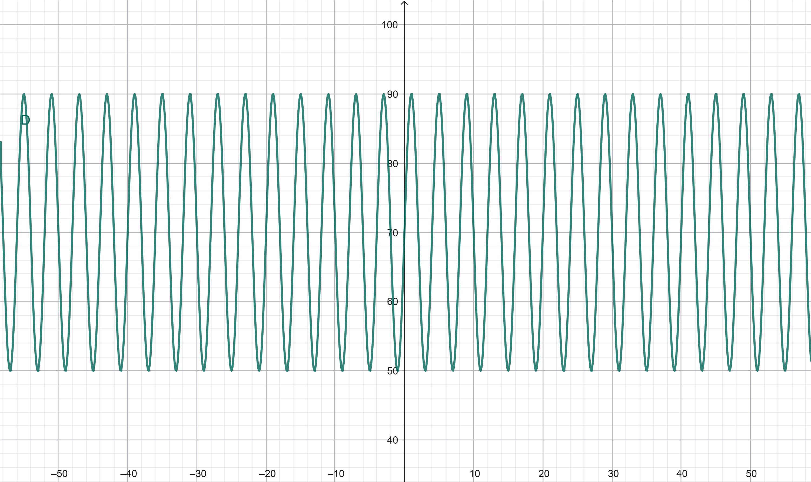

#  Desempenho Durante os Estudos — CP II

## Sobre o projeto
Este projeto apresenta uma aplicação de funções trigonométricas em uma situação do cotidiano: a variação do desempenho de uma estudante durante uma sessão de estudos.

O objetivo é mostrar como a função seno pode representar oscilações de desempenho em um modelo matemático simplificado.

##  Objetivo
Aplicar os conceitos de funções trigonométricas estudados em aula, identificando o valor máximo, o valor mínimo e o período de uma função.

## Função utilizada
\[
D(t)=70+20\sen\left(\frac{\pi}{2}t\right)
\]

Em que:

- **D(t):** desempenho da estudante, em porcentagem.
- **t:** tempo de estudo, em horas.
- **70:** valor médio do desempenho.
- **20:** amplitude da função.

## Resultados

- **Desempenho máximo:** 90%.
- **Desempenho mínimo:** 50%.
- **Período:** 4 horas.

## Tecnologias utilizadas
- HTML5 — estrutura do site.
- CSS3 — estilização e organização visual.
- GeoGebra — visualização e análise do gráfico da função.

## Conceitos matemáticos
O projeto utiliza a função seno para estudar um fenômeno periódico e aplicar a fórmula do período:

\[
T=\frac{2\pi}{|k|}
\]

Como \(k=\frac{\pi}{2}\), temos:

\[
T=\frac{2\pi}{\pi/2}=4\text{ horas}
\]

## Imagem do Gráfico da Função

## Site no GitHub Pages

## Observação
A função é um modelo hipotético para fins educacionais. O desempenho real de uma pessoa não varia necessariamente de forma periódica.

## Integrante
- Luiza de Freitas Benevides

## Disciplina
**CP II — Aplicações da Trigonometria no Cotidiano**
